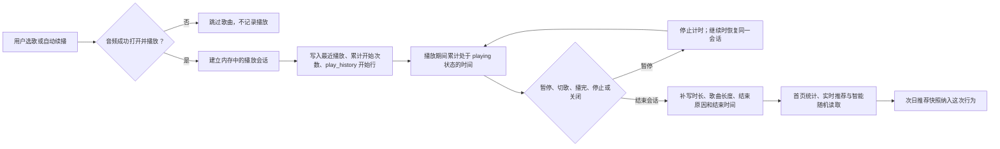

# 播放行为、统计与推荐流程（数据库 v5）

本文记录当前实现的实际口径。时间戳和播放时长在 `play_history` 中均以毫秒存储；按天展示和生成榜单时使用设备的本地日期。这里的“播放次数”“有效收听”“完播”和“推荐中的听完”是不同概念。

## 一次播放的完整链路



1. 用户点击歌曲、播放列表或推荐歌单后，播放器确定队列和本次播放来源；自动续播由播放器选择下一首。无效或打不开的歌曲会跳过。只有 `audioBridge.play()` 成功后才调用 `beginHistory()`。同一首歌的暂停后继续沿用当前会话，不重复记一次开始。
2. `beginHistory()` 记录 `eventStartedAt = Date.now()`，并异步调用主进程的 `savePlayHistory`。该方法在一个数据库事务内更新最近播放 `history.play_time`、将 `song.play_times` 加一、插入 `play_history` 开始行。开始行的 `played_ms` 为 0，结束数据尚为空。按 `song_id + started_at` 查重，避免结束 IPC 比开始 IPC 先到时重复插入。
3. 播放器在内存中用 `Date.now()` 累加处于播放状态的时间；暂停时停止计时，恢复时继续。拖动进度不会直接改变累计值。运行中不逐秒写数据库。
4. 自然播完记 `ended`；下一首、上一首、手动选歌、停止分别记 `next`、`previous`、`selected`、`stopped`；关闭窗口记 `closed`。结束时 `recordPlayEvent` 更新开始行的 `played_ms`、`duration_ms`、`end_reason`、`start_origin`、`ended_at`。关闭窗口走同步 IPC。若结束请求先于异步开始写入到达，结束处理会先插入完整行，后到的开始处理不会再插入第二行。
5. 结束时累计时间不足 1 秒，`recordPlayEvent` 不补写。这次成功开始仍已更新 `history`、`song.play_times`，并留下一条 `played_ms = 0` 的开始行。结束处理成功后，播放器重新读取实时推荐分数供智能随机使用。

播放来源 `start_origin` 的取值与入口如下：

| 值               | 当前含义                                           |
| ---------------- | -------------------------------------------------- |
| `automatic`      | 自动续播；无法识别来源时的默认值。                 |
| `manual`         | 用户从列表、队列等入口主动选歌，或手动点击下一首。 |
| `search`         | 在歌曲列表输入关键词后点击搜索结果。               |
| `return`         | 点击上一首，回到先前歌曲。                         |
| `recommendation` | 从推荐页面或首页推荐歌单开始播放。                 |

来源记录的是**这次开始播放的方式**。结束原因记录的是**这次播放如何结束**。例如搜索后很快点击下一首，会得到 `start_origin = search`、`end_reason = next`。当前新写入的播放行没有传入歌单 ID/名称，所以 `playlist_id`、`playlist_name` 通常为空；v4 迁移来的历史记录仍保留原有值。

## 持久化数据与统计口径

| 数据                   | 写入时间与用途                                                             |
| ---------------------- | -------------------------------------------------------------------------- |
| `history`              | 每首歌仅一行，成功开始时更新最近一次播放时间；用于“最近播放”列表。         |
| `song.play_times`      | 每成功开始一次加一，是**开始次数**，不是有效收听次数。                     |
| `play_history`         | 每次开始一行，结束时补全；提供播放日期、累计时长、排行、完播率及推荐行为。 |
| `song.preference`      | 用户明确标记的喜欢 `1`、中性 `0`、不喜欢 `-1`，与播放事件分开存储。        |
| `recommendation_daily` | 某个本地日期的固定推荐分组、截止时间和生成时间；播放时不直接写入。         |

`play_history` 中，`started_at` 是开始播放的时间，`created_at` 是数据库插入这行的时间，`ended_at` 是结束请求被处理的时间；这三个字段均为 Unix 毫秒时间戳。`played_ms` 是实际累计的播放状态时长，`duration_ms` 是歌曲时长；`start_origin` 和 `end_reason` 分别描述开始与结束。`ended_at - started_at` 包含暂停等间隔，不能代替 `played_ms`。

首页各统计从数据库查询，口径如下：

| 展示             | 计算方式                                                                                                                                                                |
| ---------------- | ----------------------------------------------------------------------------------------------------------------------------------------------------------------------- |
| 总时长、今日时长 | 分别汇总全部、开始日期为本地今天的 `play_history.played_ms`，转换为秒后展示。                                                                                           |
| 热力图           | 按 `started_at` 的本地日期分组，汇总 `played_ms`；默认查询近 365 天。                                                                                                   |
| 播放次数排行     | 按歌曲统计 `play_history` 行数，因此包含已经开始但未形成有效收听的记录。                                                                                                |
| 播放时长排行     | 按歌曲汇总 `played_ms`。                                                                                                                                                |
| 时间段           | 对 `played_ms > 0` 的行，按**开始播放时**的本地小时归入深夜 0–5、早晨 6–10、中午 11–12、午后 13–14、下午 15–17、晚上 18–23，并汇总时长和次数。一段跨时段播放不会拆分。  |
| 首页完播率       | 分母为 `played_ms >= 5000` 且已知歌曲时长的播放；分子为其中 `played_ms >= 歌曲时长 × 0.9` 的播放。优先使用记录中的 `duration_ms`，缺失时回退到 `song.duration × 1000`。 |

首页统计在页面加载或手动刷新时重新查询；播放进度变化不会持续刷新卡片。这里的 90% 是首页完播率口径，推荐算法使用下面的 80%“听完”信号。

## 推荐模型的输入

实时推荐分数与每日推荐共用 `getRecommendationScores()`。候选是 `song_status != 0` 的歌曲，读取 `song.preference`、累计开始次数、导入时间和最新标记、艺人/专辑/流派/年份/长度及标签，再读取最近 90 天的 `play_history`。没有标签的歌曲仍可参加推荐。

播放事件在评分时需满足：`started_at` 位于评分时刻之前的 90 天内，且推算的结束时间也早于评分时刻。结束时间优先取 `ended_at`，否则取 `started_at + played_ms`。未结束的开始行可能出现在“最近播放事件数”中，但其 0 毫秒时长不会构成听完、有效收听或主动选择的正向证据。

为了避免把同一次收听重复计算，模型用 `legacyPlays = max(0, song.play_times - 最近事件行数)` 估计较早的累计播放，再加上最近事件中的有效收听估计。这个差值是兼容旧累计数据的近似量，并不等同于逐次验证过的有效收听。

### 单次事件如何形成行为证据

设 `ratio = played_ms / duration_ms`；事件没有有效 `duration_ms` 时回退到歌曲时长。近 90 天事件按 `decay = exp(-距今的天数 / 90)` 衰减。下表的事件贡献均乘以该衰减值，除非另有说明。

| 信号             | 判定与贡献                                                                                                                                          |
| ---------------- | --------------------------------------------------------------------------------------------------------------------------------------------------- |
| 推荐中的“听完”   | 有歌曲时长且 `ratio >= 0.8`；没有时长时，结束原因为 `ended` 且听了至少 60 秒。`completions += decay`。                                              |
| 快速切走         | 结束原因为 `next`、`previous` 或 `selected`，同时 `ratio < 0.25` 且听了不足 30 秒。`skips += decay`。普通停止和关闭不算快速切走。                   |
| 已听比例         | `listened += decay × clamp(ratio, 0, 1)`。                                                                                                          |
| 主动选择         | 先要求 `ratio >= 0.35` 或听了至少 60 秒；搜索 `intent += 0.8 × decay`，上一首返回 `0.65 × decay`，手动和推荐入口 `0.25 × decay`；自动续播不加此项。 |
| 重复收听日期     | `ratio >= 0.6` 时将开始日期计入去重的活跃日期集合。                                                                                                 |
| 近期有效收听估计 | `ratio >= 0.5`；无时长时，`ended` 且听了至少 60 秒也算。此项按事件计数，不按衰减求和。                                                              |

**注意：**“搜索播放”本身不立即加主动选择分；需要达到上表的时长或比例门槛。快速切走对经常听的歌影响较弱，避免把一次换口味误判为长期不喜欢。

### 行为分、属性分与最终权重

每首歌先得到以下行为分项：

| 分项                   | 当前公式或上限                                                                                    |
| ---------------------- | ------------------------------------------------------------------------------------------------- |
| 听完 `completion`      | `completions × 1.2`                                                                               |
| 已听 `listened`        | `listened × 0.45`                                                                                 |
| 多天重听 `repeat`      | `min(2, max(0, 活跃日期数 - 1) × 0.8)`                                                            |
| 主动选择 `intent`      | `min(2, intent)`                                                                                  |
| 快速切走 `skips`       | `-skips × 0.85 × skipReliability`，其中 `skipReliability = max(0.25, 1 / (1 + 有效收听估计 / 3))` |
| 较早累计播放 `history` | `min(1.5, ln(1 + legacyPlays) × 0.35)`                                                            |

上述分项相加得到 `evidence`，再算 `behavior = clamp(evidence, -1.5, 4) × 0.5`。明确喜欢的歌曲在学习属性偏好时使用证据值 3；明确不喜欢的歌曲不向属性偏好贡献正向样本。其他歌曲的 `evidence` 大于 0.5 才成为正向样本，贡献量为 `min(2, clamp(evidence, -2, 4)) / 2`。

属性偏好按艺人、同一艺人下的专辑、流派、标签、发行年代和时长档分别累积。时长档为 30–179 秒、180–359 秒、360 秒及以上。每个属性匹配度为 `clamp(正向样本贡献和 / (曲库中该属性歌曲数 + 2), 0, 1)`；缺失的属性匹配度为 0。标签取该歌曲所有标签中**最高**的匹配度。匹配度再乘以下列系数并求和：

| 艺人 | 专辑 | 流派 | 标签 | 年代 | 时长档 |
| ---: | ---: | ---: | ---: | ---: | -----: |
| 0.20 | 0.18 | 0.16 | 0.18 | 0.08 |   0.06 |

最后还有四个独立因子：

| 因子                 | 当前公式或取值                                                                                                                                                                                        |
| -------------------- | ----------------------------------------------------------------------------------------------------------------------------------------------------------------------------------------------------- |
| 明确喜欢 `feedback`  | 喜欢加 `1.5`；中性加 0。不喜欢直接将最终权重设为 `0.06`。                                                                                                                                             |
| 最近导入 `freshness` | 实时评分使用 `is_newest`；每日快照按截止时刻重新判断最新导入批次。命中且导入日期有效时为 `0.45 × exp(-导入后天数 / 21)`。日期全部不可用时最大歌曲 ID 会被标为最新，但因年龄未知，实际新鲜度加分为 0。 |
| 探索 `exploration`   | 最近有效收听 0 次为 `1.25`，1–2 次为 `1.08`，更多为 `1`。                                                                                                                                             |
| 近期重播 `recency`   | 有近期事件时为 `1 - 0.3 × exp(-距最近结束时间 / 48 小时)`；无事件时为 `1`。刚听完约为 `0.7`，之后逐渐回到 `1`。                                                                                       |
| 每日微扰 `variation` | 由歌曲 ID 和本地日期确定，范围 `0.96–1.04`；同一天同一首歌固定。                                                                                                                                      |

设 `similarity` 为六项属性加分之和。中性或喜欢歌曲的最终权重为：

```text
weight = clamp(
  (1 + behavior + similarity + feedback + freshness)
  × exploration × recency × variation,
  0.1,
  6
)
```

明确不喜欢时，`weight = 0.06`。因此权重主要控制排序或抽样概率，不是“喜欢概率”；各因子也不是百分比。属性不全时，相应项为 0，行为、导入日期和显式喜好仍可决定权重。

例如，暂时忽略每日微扰，并假设没有行为、属性、导入和近期重播加成：从未有效收听的中性歌曲权重为 `1 × 1.25 = 1.25`；相同条件下明确喜欢的歌曲为 `(1 + 1.5) × 1.25 = 3.125`；明确不喜欢始终为 `0.06`。其他歌曲的实际权重还会受上述行为与相似度影响，并被限制在 `0.1–6`。

## 分组、每日快照与智能随机

- **常听喜爱**：先放明确喜欢的歌曲；其他歌曲需未被判为“频繁跳过”，且满足近期听完分至少 `0.8`、有效收听估计至少 3、主动选择分至少 1，或“有效收听超过 1 且权重大于 1”中的任一条件。组内明确喜欢优先，其次按权重、播放次数排序。
- **值得探索**：候选为有效收听估计最多 2 次、未判为频繁跳过且不在常听喜爱中的歌曲。冷门池要求有效收听估计最多 1 次，优先选属性关联分更低、收听次数更少、最近播放更少的歌曲；之后比较新鲜度和每日微扰。目标是约每三个位置放一首冷门歌。其余歌曲按权重排序；两个池都按艺人交错排列，减少单一艺人连续占满。
- **减少推荐**：明确不喜欢或被判为频繁跳过的歌曲，按权重从低到高排列。当前推荐页面仍可展示此组；首页推荐卡片只展示一份当天的常听喜爱和最多三天的值得探索。

频繁跳过的分类条件为 `skips >= 1.5`，并且 `skips > completions + ln(1 + 有效收听估计) × 0.8`。推荐列表每组最多保存 100 首；页面先取 20 首，可继续加载至该上限。

单首歌显示的推荐理由按优先级选择：明确不喜欢、明确喜欢、频繁跳过、听完分至少 2、听完分至少 `0.8`、主动选择分至少 `0.6`、新鲜度至少 `0.1`，然后依次尝试标签、专辑、流派、艺人、年代、时长相似。各属性加分的理由阈值依次是 `0.02`、`0.03`、`0.02`、`0.02`、`0.015`、`0.015`。兜底理由为“未听过”，但它不保证歌曲从未播放。理由只是对分数的概括，不会额外改变权重；冷门池展示时会标记冷门选择。

首次读取当天推荐时，以**本地当天 00:00** 为截止时刻生成 `recommendation_daily` 快照：排除导入日期明确为当天的歌曲、当天开始的播放和当天才结束的会话，并从累计开始次数中扣除当天开始次数。快照保存分组、顺序和分数，当天的播放或喜欢标记不会重排已保存的榜单；次日重新计算。保留最近三天的快照供探索歌单使用。曲库发生某些变更时，代码会主动使当天快照失效并重建。

**智能随机**使用同一套实时分数，但只在当前播放队列中抽取下一首。设置中开启后，它取代普通随机：每轮尽量不重复当前轮已播放歌曲；候选耗尽后开启新一轮。抽样时约 70% 优先从“近期有效收听超过 2 次或明确喜欢”的候选池选，接下来的约 20% 优先探索近期有效收听最多 2 次的候选，其余从全部候选选；目标池为空时会回退。池内按 `max(0.02, weight × diversity)` 加权随机，同艺人或同专辑的下一首乘 `0.4`。播放结束或修改喜好后会重新读取实时分数，影响后续抽样，不改当天快照。

## 当前实现的边界

- `played_ms` 来自播放器处于播放状态的墙上时间，不来自解码帧数；改变播放速度时，它与歌曲媒体进度可能不同。拖动到结尾不会凭空增加已听时间。
- 成功开始就增加 `song.play_times`，所以“开始次数”和“有效收听估计”可能相差很大；不足 1 秒的结束只留下零时长开始行。
- 最近事件数和较早累计播放的拆分是一种估算；v4 以前只有累计播放与旧播放记录，无法还原所有单次行为来源或结束原因。
- 从正式 v4 升到 v5 时，旧 `played_seconds` 转成 `played_ms`，旧开始和创建时间统一为毫秒；无法从旧记录推断的歌曲时长、结束原因和结束时间保持为空，来源设为 `automatic`。
- 首页完播率为 90%，推荐中的“听完”为 80%，探索中的“有效收听”为 50%（无歌曲时长时有额外兜底），三个阈值服务于不同用途。
- 每日推荐冻结列表成员、顺序和分数；读取歌曲详情时，当前喜欢标记仍从 `song.preference` 取得，因此按钮状态可即时更新。

## 代码入口

- [播放会话、计时与结束事件](../src/renderer/src/stores/player/playerStore.ts)
- [播放开始写入与首页统计查询](../src/main/database/repository.ts)
- [推荐评分、分组、快照与结束补写](../src/main/database/recommendations.ts)
- [完播率与时间段](../src/main/database/listeningStats.ts)
- [智能随机抽样](../src/renderer/src/stores/player/smartShuffle.ts)
- [v5 表结构](../src/main/database/schema.ts)
