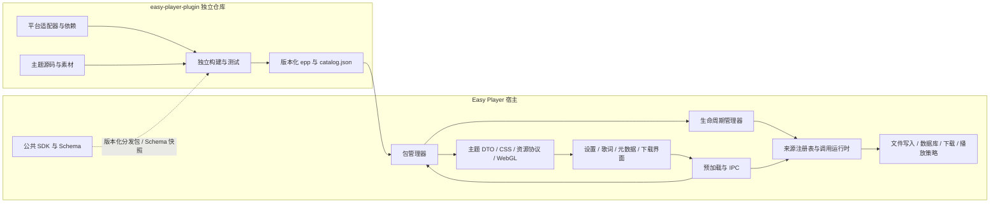
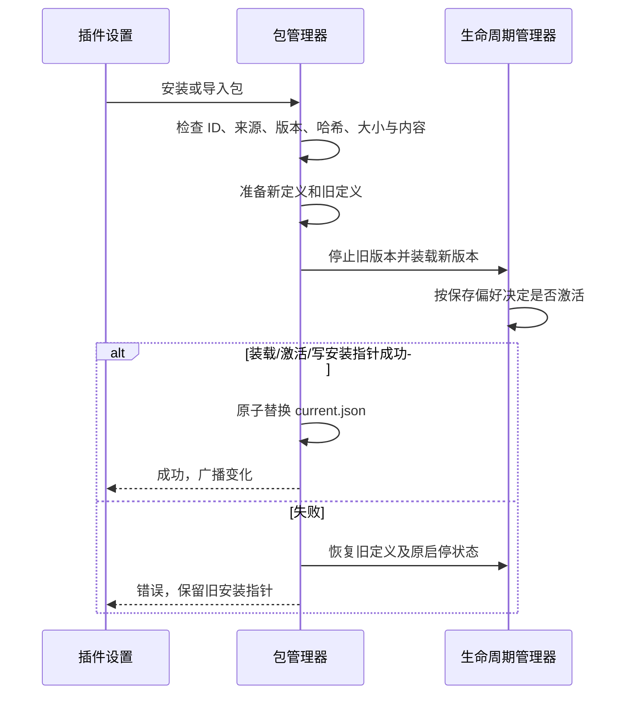

# 插件系统实现与维护总览

本文按当前工作区代码梳理系统，不代表远端 Release 已包含这些改动。主题与作者元信息属于本轮待交付能力。旧网络来源文档保留了阶段记录，当前实现以本文、公共 SDK 和加载器代码为准。

## 1. 当前范围

| 类型           | 贡献内容                                                  | 执行方式                                             | 安装与更新                                        |
| -------------- | --------------------------------------------------------- | ---------------------------------------------------- | ------------------------------------------------- |
| 官方来源插件   | 歌词、封面、元数据、媒体搜索与下载计划                    | 主进程加载可信 CommonJS 代码                         | 固定官方索引，支持手动安装/更新及索引认证的本地包 |
| 官方主题插件   | 配色、规则、图片、字体、文字、GLSL 或 Canvas/SVG/CSS 背景 | 数据/shader 由宿主渲染，代码背景在受限沙箱框架内运行 | 官方索引或认证的本地包                            |
| 第三方主题插件 | 配色、规则、图片、字体、文字、GLSL 背景                   | 数据与资源加载，不执行包内 JS                        | 本地导入；更新时重新导入相同 ID 的包              |

当前本地官方索引包含五个来源和十个主题：

| 插件 ID                                                                    | 版本     | 来源 ID / 能力                             |
| -------------------------------------------------------------------------- | -------- | ------------------------------------------ |
| builtin.netease                                                            | 1.1.0    | netease：lyrics、artwork、metadata         |
| builtin.kugou                                                              | 1.1.0    | kugou：lyrics、artwork、metadata           |
| builtin.qqmusic                                                            | 1.1.0    | qqmusic：lyrics、artwork、metadata         |
| builtin.bili                                                               | 1.1.0    | bili：download                             |
| builtin.youtube                                                            | 1.1.0    | youtube：download                          |
| builtin.theme.blackhole                                                    | 1.0.1    | 主题，sources 为空                         |
| builtin.theme.rainy                                                        | 1.0.0    | shader 主题，sources 为空                  |
| builtin.theme.{aurora,ocean,sunset,forest,matrix,starfield,startrails,dna} | 各 1.0.0 | 八个独立的官方 renderer 主题，sources 为空 |

应用默认不安装这些插件，也不在启动时自动下载插件或刷新索引。内置基础外观仍由应用提供；黑洞、雨夜及八个个性化背景均已迁出；应用保留无背景、跟随歌曲和本地媒体能力。

当前不提供通用第三方脚本插件、插件 UI 页面、DSP 插件、流媒体播放接口，也没有统一的登录/鉴权贡献协议。AUTH_REQUIRED 错误代码已经存在，但不等于登录能力已接入。

## 2. 工程与模块职责



| 位置                                        | 职责                                                                                 |
| ------------------------------------------- | ------------------------------------------------------------------------------------ |
| packages/plugin-sdk                         | 公共类型、定义辅助函数、错误代码及主题 Schema；不依赖 Electron、数据库或应用内部模块 |
| src/main/plugins/packages.ts                | 官方索引、包校验、安装更新事务、启动恢复、卸载、主题内容缓存                         |
| src/main/plugins/manager.ts                 | 清单校验、来源所有权、同步生命周期、激活原子性与清理                                 |
| src/main/plugins/management.ts              | 数据库设置、启停偏好、宿主服务注入与管理操作                                         |
| src/main/plugins/runtime.ts                 | 延迟创建进程内唯一管理器和来源注册表，退出时关闭                                     |
| src/main/sources                            | 来源能力路由、参数校验、超时、取消、错误归一与下载许可                               |
| src/main/ipc/*                              | 管理操作、来源调用和窗口通知的 IPC 入口                                              |
| src/preload                                 | 暴露限定 API 与可序列化 DTO，不暴露插件实现函数                                      |
| src/main/service                            | 标签写入、数据库同步、媒体提取、下载执行及播放策略                                   |
| src/shared/themePlugins.ts / themeStyles.ts | 主题数据与安全 CSS 语法校验                                                          |
| src/renderer/src/services/pluginThemes.ts   | 每个窗口的主题订阅、异步结果代次管理                                                 |
| src/renderer/src/services/customTheme.ts    | 合并后的样式、资源槽位、字体加载与撤销                                               |
| DeclarativeThemeBackground.vue              | 声明式静态/shader 背景渲染与 GPU 生命周期                                            |
| SandboxedThemeBackground.vue                | 沙箱框架内的代码背景渲染与消息生命周期，仅向认证官方包开放                           |
| 独立仓库 official / shared                  | 来源平台实现、歌词处理、流派归一化与公共适配逻辑                                     |
| 独立仓库 themes / examples                  | 官方主题源码、第三方主题示例与授权素材                                               |
| 独立仓库 scripts / schemas                  | 独立构建、打包预检与固定的主题契约快照                                               |

应用的普通构建和运行不读取独立插件仓库。联调命令通过同级 easy-player-plugin 或 EASY_PLAYER_PLUGIN_DIR 定位它；独立项目不应导入应用内部源码。

## 3. 身份、清单与版本

插件 ID 标识安装单位，例如 builtin.qqmusic；来源 ID 标识插件贡献的能力实例，例如 qqmusic。一个代码插件可以声明多个来源，来源 ID 在注册表中必须唯一。

共同清单字段为 id、displayName、version、apiVersion、sources，以及可选 author。主题额外要求 kind: theme、theme 元信息、API 2、sources: []。来源插件沿用历史格式，kind 省略。主题的本地化名称仅支持 zh/en，缺失时回退 displayName。

```json
{
  "id": "alice.nyan-cat",
  "displayName": "Nyan Cat",
  "author": { "name": "Alice", "url": "https://example.com/alice" },
  "version": "1.0.1",
  "apiVersion": 2,
  "kind": "theme",
  "theme": { "displayName": "Nyan Cat" },
  "sources": []
}
```

名称和作者名允许重复。不同 ID 并存；相同 ID 走更新语义，名称或作者变化不会创建新插件。插件列表显示作者和 ID，主题卡片在重名时显示 ID。作者字段可省略以兼容旧包，它不决定官方身份，也不提供发布者认证。第三方应使用自己的账号/组织命名空间，不能使用 builtin. 前缀。

| 版本维度              | 当前含义                                          |
| --------------------- | ------------------------------------------------- |
| 应用版本              | 宿主实际具备哪些能力                              |
| SDK 版本              | 公共开发契约版本；当前工作区 2.1.0                |
| 插件 apiVersion       | 当前新包使用 2；已发布 API 1 来源通过兼容桥接加载 |
| 来源 apiVersion       | NetworkSource 数据/能力协议，仍为 1               |
| 主题 version          | theme.json 数据格式，仍为 1                       |
| 插件 version          | 每个安装单位独立更新的内容版本                    |
| catalog schemaVersion | 索引结构，当前为 1                                |

SDK 2.1 与主题能力尚待本轮交付，官方来源仍固定 SDK 2.0 分发包。API 2 本身不说明旧宿主是否支持主题，当前没有 minAppVersion、能力协商或插件依赖图。

## 4. 包格式与磁盘布局

.epp 是 ZIP。来源包包含 manifest.json、index.cjs 及依赖许可；依赖随构建打包，安装时不运行 npm install。主题包包含 manifest.json、theme.json 与声明的图片、字体、着色器、纹理及许可，不需要 index.cjs。官方 renderer 包另有 background.js，交给沙箱框架，不在主进程执行。

```text
<Electron userData>/plugins/
  catalog.json                         缓存的官方索引
  <pluginId>/
    current.json                       当前安装记录
    <sha256>/
      manifest.json
      package.epp
      index.cjs                        仅来源代码包
```

安装目录按内容哈希分版本。current.json 保存清单、大小、SHA-256、分发地址，以及第三方来源标识等安装信息。主题资源直接从已校验的包内容提供，不通用解压到文件目录。

| 限制     | 来源包                           | 主题包                                                     |
| -------- | -------------------------------- | ---------------------------------------------------------- |
| 压缩包   | 16 MiB                           | 16 MiB                                                     |
| 条目数   | 256                              | 128，目录也计数                                            |
| 解压总量 | 64 MiB                           | 32 MiB                                                     |
| 特殊约束 | 必须有代码入口，须经官方索引认证 | JSON 各 128 KiB、GLSL 256 KiB、资源 64 项、纹理总量 16 MiB |

主题的其他路径、压缩方式、签名与容量限制详见 [主题规范](theme-plugins.md)。已有旧 JSON/ZIP 主题仍从原 UUID 资源目录读取，供选择和删除；不再提供旧格式的导入和导出入口。新主题统一通过 .epp 插件安装。

## 5. 启动、安装与更新

### 启动

1. 数据库打开后配置宿主网络、设置、日志及媒体提取服务。
2. 包管理器读取官方离线种子与有效缓存；缓存存在时优先使用缓存，不在启动阶段联网刷新。
3. 遍历 current.json，校验保存的记录、包大小、哈希与内容，然后装载定义。
4. 来源先预留清单贡献 ID，再按 plugins.disabled 恢复插件状态；来源自己的偏好由 network-sources.disabled 单独恢复。
5. 单个坏包或激活失败独立记录，不阻止其他插件工作。退出时先清理插件，再关闭数据库。

启动依赖本机保存的安装记录，不与最新远端索引逐一联网比对。不存在安装指针的版本目录与旧版本在后续启动清理。

### 安装与更新事务



同一插件安装期间禁止并发更新、卸载或修改启停。低版本拒绝；当前同版本允许重新导入，但正式发布内容变化仍应升版。官方与第三方安装来源不可借同一个 ID 相互替换。

官方安装使用索引声明的 URL、大小、SHA-256 与完整清单。来源代码仅允许固定官方分发地址，API 1 保留旧官方仓库的兼容地址。固定 URL 与 HTTPS 是当前信任根，尚无独立包签名。

本地导入先匹配当前索引或应用内置种子的哈希；匹配的包按官方包安装。未匹配时仅接受完整验证的数据式主题，拒绝第三方来源代码和 builtin. ID。缓存索引较旧时，种子中固定的官方主题包仍可本地导入。

卸载先移除安装指针，再撤销插件、来源及主题资源访问；插件配置保留。本进程保留的旧版本目录用于已接纳下载的生命周期，后续启动再清理。

## 6. 来源生命周期和调用流程

状态为 inactive、activating、active、deactivating、failed。load 完成声明预留；activate 期间来源实现先暂存，全部与清单一致后才公开注册。能力不符、缺失方法、来源 ID 冲突或未完成注册都会使本次激活失败，并撤销已登记资源。

activate、deactivate 与清理回调使用同步契约；网络能力调用异步执行。宿主通过 own 登记资源并逆序释放，某个清理失败不会跳过其余清理。停用会关闭上下文并触发生命周期信号，旧注册回调不能移除重新激活的新实例。

典型调用路径：

```text
界面操作
  → preload 的结构化请求
  → network-sources:invoke
  → 窗口拥有的 requestId / AbortController
  → 参数、播放模式、插件及来源状态检查
  → invokeSource：超时、取消、能力路由和基础返回校验
  → NetworkSource 方法
  → 标准 DTO / SourceFailure
  → 界面展示与后续宿主操作
```

窗口只能取消自己拥有的请求；窗口销毁会取消其在途调用，每窗口最多 64 个在途 requestId。插件或来源停用会取消普通调用。默认超时按操作为 15–60 秒，失败转换为 TIMEOUT、CANCELLED、SOURCE_DISABLED、AUTH_REQUIRED 等稳定代码，界面负责本地化。

SourceResourceRef 用 sourceId、resourceType、resourceId、可选 subId 标记平台资源；搜索候选显示名不承担资源身份。跨 IPC 传递描述和数据，不传递 provider 函数、响应对象、Vue 代理或凭据。

宿主服务包括：

| 服务                 | 提供内容                           | 实际边界                                                                   |
| -------------------- | ---------------------------------- | -------------------------------------------------------------------------- |
| network.fetch        | 合并调用与生命周期取消的网络请求   | 生命周期协作接口，尚无通用域名权限审批或配额体系                           |
| media.extractInfo    | URL 或搜索条件对应的结构化媒体信息 | 宿主构建工具参数，不接受任意命令和输出路径                                 |
| settings             | 插件命名空间下的 JSON 配置         | 键和值校验、复制；序列化后的单值 JSON 长度最多 65536；不承担凭据保险库职责 |
| log                  | 附插件身份的日志                   | 不应记录令牌、Cookie 等敏感值                                              |
| registerSource / own | 来源贡献与资源清理                 | 绑定当前插件作用域及状态                                                   |

部分上游平台 SDK 仍使用自己的网络实现；宿主能丢弃取消后的结果，但不能保证这些库的底层请求都立即终止。SDK 服务规范属于可信代码的集成边界，不能当作恶意代码的权限隔离。

## 7. 元数据写入与下载

### 元数据

来源负责搜索、详情、歌词与封面候选，平台侧进行字段归一化。用户选择字段后，由宿主对本地歌曲应用修改：

```text
搜索与选择候选 → 读取文件快照 → 展示字段差异
→ 用户勾选字段 → 校验 expectedRevision
→ 按歌曲串行写文件 → 重新读取文件标签 → 同步数据库与界面
```

revision 包含文件状态和元数据，避免预览期间文件变化后覆盖修改。当前以文件为实际来源，没有另建 song_metadata_override 覆写层。宿主检查远端歌曲、文件存在性、格式和封面数据；当前解码器仍持有的文件会被跳过，暂停/停止仍可能持有句柄，不能只判断“是否正在播放”。当前不提供自动等待播放结束的写入队列。

### 下载

来源提供 search、parse、resolve。resolve 返回 HTTP 或 yt-dlp 的结构化下载计划；宿主拥有目录、任务 ID、进度、网络执行、外部进程、文件名及音频后处理。插件不会通过公共请求收到目标目录或任意 shell 命令入口。

开始任务前按 URL 与来源 ID 校验状态；已接纳的 download.resolve 获得宿主颁发的临时许可，允许它在插件停用后完成本次资源解析。普通、伪造或过期上下文不享有这个例外。

插件停用/卸载不主动取消已接纳的宿主下载，但新搜索和任务创建被拒绝。轻量播放模式、宿主取消、工具失败和应用退出仍可停止工作。上述接口提供下载，不承担网络流媒体播放。

## 8. 主题加载与资源生命周期

主题装载先验证 JSON、文件声明、资源格式头、GLSL、有限浮点纹理及图片纹理声明，随后向渲染窗口提供 InstalledPluginTheme。主题在管理器中以空代码生命周期参与启停；实际 CSS、字体与 GPU 资源由窗口维护。

```text
插件变化事件 → plugins:themes → 窗口订阅更新
→ 动态加入背景注册表 → 用户选择 plugin:<id>
→ 外观解析 / 主题合并 → CSS、文本、FontFace、背景画布
```

配色、规则、资源槽位及文本只在插件选中、设计明暗模式匹配且没有相应背景覆盖时应用；背景自身可在其他模式显示并接受可读性处理。用户自定义主题保持优先级；原生材质或自定义主题背景按现有外观策略覆盖。导入插件不会自动切换主题。

图片、字体和纹理仅通过以下内部协议访问：

```text
easy-player-media://plugin-theme/<pluginId>/<sha256>/<declared-path>
```

协议只提供当前启用版本已声明的运行资源。旧哈希、停用、卸载或未知路径返回不可用；授权文件保存在包中，不作为运行资源暴露。

字体加载使用代次避免旧异步结果附着，切换时移除旧字体。CSS 复用未变化的样式节点。WebGL 等待纹理后初始化，图片纹理解码后核对声明尺寸、生成 mipmap，shader 可选择 1–30 FPS；宿主管理帧率、自适应分辨率、指针、窗口隐藏、失焦及减少动态效果；卸载先隐藏画布，再取消请求、动画、监听并释放 GPU。

编译/链接/资源失败显示静态回退并提示，不自动撤销已安装版本。第三方主题没有 JS 入口；官方 renderer 只有受限背景框架入口。CSS 仍可能影响可操作性，字体和图片仍需 Chromium 解码，shader 仍有 GPU 成本；这与包结构检查是不同层面的约束。

旧 blackhole、rainy 及八个个性化背景名称不再兼容或自动映射，读取旧配置时使用默认无背景。新 plugin:<id> 选择在插件缺失、停用或卸载后回退并保留，重新安装/启用后恢复。旧 JSON/ZIP 导入、导出和示例下载入口及对应 IPC 已移除；已有旧主题仅保留选择和删除管理，所有新主题通过插件管理导入 .epp。

## 9. 信任与未实现的能力

| 方面      | 当前实现                                       | 后续扩展前需要的工作                             |
| --------- | ---------------------------------------------- | ------------------------------------------------ |
| 来源代码  | 只接纳官方索引认可的可信代码，在主进程执行     | 第三方代码进程隔离、能力授权、资源限制与崩溃恢复 |
| 作者与 ID | 作者自报、ID 唯一、builtin. 保留、来源冲突拒绝 | 若需认证，另建设发布者身份、签名与命名空间治理   |
| 官方分发  | 固定 HTTPS 索引、包哈希和大小、元信息一致性    | 独立签名、撤销、索引回滚保护等分发机制           |
| 更新      | 用户手动刷新/安装；第三方主题重新导入          | 后台自动更新及第三方目录协议                     |
| 兼容      | API 1 桥接、API 2 加载、主题格式 1             | minAppVersion、能力协商、依赖与配置迁移协议      |
| 鉴权      | 错误代码和普通设置接口                         | 登录流程、作用域、令牌刷新、撤销、系统安全存储   |
| 扩展点    | 来源能力和声明式主题                           | UI、DSP、流媒体等需各自定义贡献协议              |

官方来源代码能使用 Node 运行环境；SDK 不提供数据库或文件写入 API，并不意味着同进程代码在技术上无法访问这些资源。当前边界建立在官方代码可信及代码审查上。源码解耦、可独立打包和恶意代码隔离是不同的完成条件。

## 10. 发布与版本更新

### 官方来源与主题

固定分发配置由独立仓库 distribution.json 指定：Huiiro/easy-player-plugin，Release 标签 plugins。所有插件使用同一个 Release 资产集合，索引指向当前版本，不要求每个插件创建独立 Git 标签。

1. 修改目标插件源码并提升其版本。来源通常在 defineSourcePlugin 的版本参数处修改；官方主题在 themes/<name>/manifest.json 修改。
2. 在插件仓库运行 npm ci --ignore-scripts、npm run build、npm test。官方构建输出五个来源包、十个官方主题和 catalog.json。
3. 检查版本、哈希与索引差异。公共 shared/、SDK、依赖及许可信息变化可能影响多个包，受影响包都应升版。
4. 提交源码、必要锁文件、Schema 快照与生成的 catalog.json，然后推送。
5. 手动运行 Publish official plugins。工作流独立安装依赖、重建、比较已提交索引、测试，再先上传 dist/*.epp，最后上传 catalog.json。
6. 用户刷新官方索引后按需更新；当前不自动后台安装更新。

文件名为 id-version-sha256前12位.epp，完整 SHA-256 与大小存于索引。当前构建/发布统一处理所有官方包，但版本独立；其他输入不变时，未修改包的版本与哈希保持不变。Release 旧资产不会因这次上传自动删除。

更新失败的本机事务会恢复旧版本；已成功更新后的主动降级会被拒绝。发现已发布版本问题时，通常发布更高版本的修复包，不能仅把索引改回较低版本就期待所有客户端回退。

首次发布主题需要先交付支持主题的宿主，再发布主题索引。实际远端内容应以相应工作流与 Release 校验为准，工作区构建产物不等于已发布资产。

### 第三方主题

```sh
npm run pack:theme -- examples/nyan-cat dist/examples
```

作者递增 manifest.json 中自己的版本并保留 ID，将生成的 .epp 发布到自己维护的位置。用户下载后通过插件入口导入更新。当前不能添加任意第三方索引地址。examples/ 中的包通过 build:examples 生成，未列入官方 catalog，也不在官方工作流 dist/*.epp 的上传范围。

## 11. 开发与维护流程

### 修改插件行为

优先只修改独立插件仓库，实现既有契约。补平台响应夹具、错误和取消测试，确认字段归一化及来源 ID 不变。版本升级、构建、测试、检查索引后提交。

### 修改宿主公共契约

1. 更新 packages/plugin-sdk 的类型与明确的兼容策略；破坏性含义变化需要相应版本设计。
2. 同步宿主参数校验、返回校验、预加载类型、生命周期与界面。
3. 主题契约同时更新 Schema、槽位、样例与文档，运行 sync:theme-contract 同步独立仓库快照。
4. build:plugin-sdk 生成版本化 .tgz；来源项目确需升级 SDK 时再替换 vendor、依赖与锁文件。
5. 修改两个仓库时分别检查、提交和发布，按“兼容宿主先交付、插件后使用新能力”的顺序进行。

### 推荐验证入口

| 范围                              | 命令                                                                                               |
| --------------------------------- | -------------------------------------------------------------------------------------------------- |
| 宿主类型与构建                    | npm run typecheck；npm run build:nocheck                                                           |
| 索引、安装、API 1/2、更新回滚     | npm run test:official-plugins                                                                      |
| 第三方主题、作者、资源与身份      | npm run test:theme-plugins                                                                         |
| SDK Schema 与宿主规则同步         | npm run test:theme-contract                                                                        |
| 真实界面、CSS、字体、shader、重名 | npm run test:appearance                                                                            |
| 来源调用、错误、取消及管理        | test:source-runtime、test:source-management、test:builtin-plugins                                  |
| 原主题兼容                        | scripts/test-theme-package.mjs、test-custom-theme.mjs、test-theme-preview.mjs 及对应 Electron 检查 |
| 独立插件工程                      | 插件仓库 npm run build、npm test、npm run build:examples                                           |
| 脱离应用目录的独立构建            | 宿主 npm run test:plugin-project                                                                   |

插件项目隔离检查在应用外复制工程并独立安装、构建、测试，比较官方索引哈希。打包器固定 ZIP 元数据、规范化文本换行，二进制保持原样，并检查包外路径引用。原生材质、不同 GPU、字体覆盖与实际平台接口仍应在目标环境验收。

## 12. 进一步阅读

- [公共 SDK 说明](../packages/plugin-sdk/README.md)
- [主题宿主维护约定](theme-plugins.md)
- [独立仓库主题开发规范](https://github.com/Huiiro/easy-player-plugin/blob/master/THEMES.md)
- [网络来源阶段记录](player/network-source-architecture.md)
- [外观规则与调度](theme-architecture.md)
- [原自定义主题规则](custom-themes.md)与[资源包格式](theme-packages.md)

## 官方背景框架补充

八个既有 Canvas/SVG/CSS 主题按 [迁移约定](themes/official-scenes.md) 使用 renderer，而黑洞/雨夜继续使用 shader。包管理共用安装事务，但 renderer 字节仅向经官方索引/种子认证的包开放；第三方本地主题仍拒绝脚本。宿主生成固定 HTML，框架不启用 allow-same-origin、Node 或 preload，CSP 禁止网络连接，无法读取父文档或调用宿主 API。该 DOM/能力隔离不等于通用第三方代码沙箱或独立进程配额机制。

插件日志的查看入口、字段、记录策略与开发约定见 [插件日志](plugin-logging.md)。
