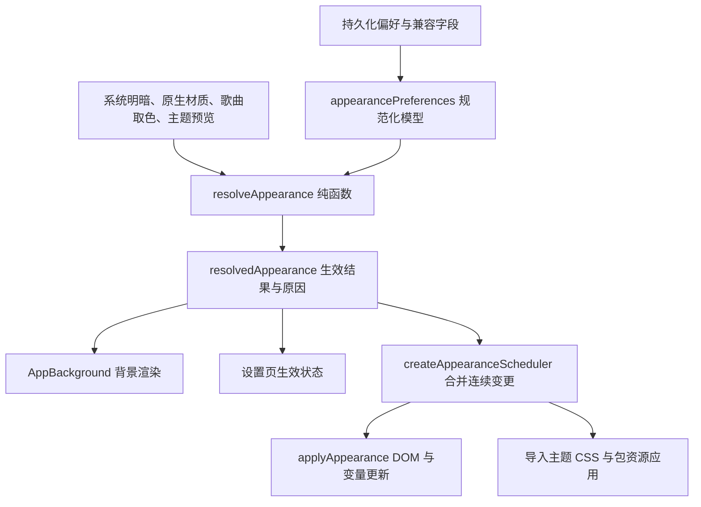

# 主题与背景规则及调度

本文描述当前实现。旧版混合“明暗、背景、主题”的规则已由统一外观解析替代。

## 状态流

解析不改写偏好；DOM 层不再自行决定优先级。调度读取最新状态，不会因一次更新尚未结束而丢弃后续变更。只在实际配色变化时写入根元素，明暗模式同帧切换，不让文字与底色插值经过灰底灰字；同一明暗及表面配色内的强调色变化保留过渡；导入主题改变文字/表面配色时同样原子应用。背景在新资源就绪后交接，旧画布保留至新背景完全覆盖后再释放；页面与播放页过渡不受影响。

背景外壳同步挂载，场景组件异步加载时先使用主题声明的背景色；歌曲背景的外壳与组件共用材质回退色。全局 `.ep-app-background` 默认样式使用低优先级，避免覆盖插件自身的加载回退，同时保留主题规则和图片槽的覆盖能力。沙盒背景收到 ready 后保留两次动画帧的绘制机会再显示，失败或卸载时取消待显示任务，避免首帧未绘制时露出文档底色。

## 独立维度

| 维度       | 选择                             | 行为                                                |
| ---------- | -------------------------------- | --------------------------------------------------- |
| 明暗       | 浅色、深色、系统                 | 独立于背景和材质；主题不设置系统明暗                |
| 强调色来源 | 自动、自定义、场景、歌曲         | 主题明确声明的强调色优先；不可用时回退并解释        |
| 全局背景   | 无、内置场景、图片、视频         | 一次只有一个基础背景；保留主题的配色与控件样式      |
| 原生材质   | 关闭、平台支持的材质             | 暂时隐藏全局背景，不改写背景与明暗偏好              |
| 主题背景   | 使用、关闭                       | 仅对提供 replace 背景的主题有效，关闭仍保留主题配色 |
| 播放页     | 封面、环境、流体；封面样式与歌词 | 独立管理；全局主题重置不改变播放页外观              |

主界面背景优先级：**原生材质透明表面 → 启用的主题背景 → 选择的场景/图片/视频 → 普通表面**。

原生材质启用时选择的新背景会保存，关闭材质后显示。跟随系统只更新有效明暗，不禁用背景。

浅色基础配色使用柔和的灰米色底，卡片/浮层略亮、控件/内嵌区域略深。浅色模式不对图片、视频或主题场景叠加全局遮罩，保持背景原本效果，只调整文字、控件和局部表面；本地媒体继续遵循用户设置的亮度与模糊。歌曲背景通过同一个着色器切换明暗材质，浅色材质降低底色亮度、增加封面色占比，不叠加白色遮罩。`resolveAppearance.backgroundScrim` 仅保留原有深色模式的可读性处理；原生材质和无背景不叠加遮罩。背景自定义边框只影响窗口装饰，不再改写全局控件边框。

自定义媒体的顶栏/底栏直接使用保存的栏位颜色，主题场景直接使用声明的顶栏/底栏及边框，不随页面浅色模式混白。深色栏位通过 `data-chrome-dark` 在 `.ep-header` / `.ep-footer` 内使用独立深色文字、图标、悬停和进度条配色；栏位与页面配色互相独立，弹窗和菜单保持所选明暗模式。无背景和歌曲背景继续使用各自的明暗配色。

浅色页面中的深色主题栏位通过 `data-chrome-raised` 将 OKLCH 明度轻抬 0.04，保留原有色相、色度和透明度；自定义媒体栏位及深色模式继续使用原色。

Mica 浅色底栏仅保留低透明度暗色衬底，不再使用近不透明的浅色面板；边框随原生背景明暗选择，外层不叠加浅色渐变。原生背景明暗由系统外观判断，页面通过 `contentDark` 适配文字和控件；不改写用户选择的明暗模式。

“跟随歌曲”的浅色背景、回退色、页面表面与顶/底栏共用 `--app-song-surface`：封面色先限制到适合浅色文字布局的明度与色度范围，再与中等亮度的中性底混合。着色器直接绘制同一材质色，顶栏略抬亮、底栏略下沉，文字和强调色同步加深；不会再使用通用近白浮层。即使强调色来源固定为用户颜色，封面变化也会单独更新材质色。

进入或离开歌曲材质时，按基础配色切换同帧应用，避免普通浅色与歌曲配色之间的底色、文字过渡不同步；歌曲材质内部的切歌取色仍保留颜色过渡。

非主题覆盖的强调色在浅色模式中保留色相并限制明度和饱和度，避免高饱和颜色在 sRGB 映射后过亮；用户保存的颜色不变。歌曲原始填充仍单独计算黑/白前景，浅色模式也应用这套按钮对比度规则。

所有主操作统一消费 `--btn-primary-bg/text/bg-hover`，不再将强调色与固定白字组合。普通强调色、歌曲填充和栏位强调色都由同一取色函数计算黑/白前景及悬停色。危险操作使用随材质衍生的低饱和表面；成功、警告与错误文字在浅色模式中使用更深的语义色，歌曲浅色材质单独加强文字对比度。Select 与 Menu 共用 8% 选中底色、4% 活动底色，避免高比例强调色叠加降低选中项文字对比度。

主窗口与迷你播放器共用 `applyCompactAppearance` 应用明暗、强调色、按钮前景和歌曲材质。迷你播放器接收 `backgroundSurface`，不再用窗口装饰边框覆盖组件边框；其明暗跟随实际内容对比度，深色场景在浅色逻辑模式下仍使用可读的紧凑窗口配色。基础和局部配色集中在 `theme.css`，组件材料及结构留在 `components.css`，控件尺寸与交互留在 `controls.css`。

## 强调色来源

- 自动：有效场景使用场景配色；solid 场景有封面时使用歌曲取色；其他背景使用自定义颜色。
- 自定义：独立使用用户颜色。
- 场景：使用所选场景的颜色，即使背景暂时被材质或主题隐藏；没有场景时回退自定义颜色。
- 歌曲：有封面取色时使用封面色，不限制背景类型；缺失时回退自定义颜色。
- 有效导入主题声明了 `--color-primary`：覆盖以上来源，设置页显示“当前主题”。

设置页同时显示实际背景、强调色来源及隐藏/回退原因。自定义颜色仍可编辑，作为用户来源与回退值。

## 统一操作入口

- `setColorMode`：仅改变明暗选择。
- `selectThemeBackground`：选择基础背景，并关闭主题背景；不退出已选主题。
- `setCustomBackground`：本地媒体导入调用相同背景选择规则，不直接操作多个开关。
- `clearCustomBackground`：清除本地背景，不改变主题、强调色或明暗。
- `selectCustomTheme`：应用所选主题，默认启用其背景；选择默认主题时保留基础背景。
- `setNativeWindowMaterial`：等待主进程成功后更新材质状态，不再保存/恢复不断叠加的偏好快照。
- `resetTheme`：先关闭原生材质，成功后恢复主界面外观默认；失败不继续改写偏好。保留导入主题资源、播放页背景与封面样式。确认框等待异步完成并展示失败。

## 导入与预览兼容

主题 JSON/ZIP 格式保持 version 1；replace/inherit、变量、规则、图片、字体和文字接口保持兼容。

导入预览临时使用候选主题及其背景；取消/超时恢复先前主题和背景策略，确认才保存新主题及默认背景策略。预览状态不持久化。

未变化的主题复用原样式节点与样式表，避免配色更新导致图片/字体规则反复卸载。变量继续使用原有 CSS 契约：普通明暗基础值 → 场景配色 → 运行时变量 → 主题根级 tokens 的 !important。局部变量、组件样式和后代声明仍遵循 CSS 层叠规则。

## 存储与迁移

为了兼容现有偏好和导出数据，旧字段暂时保留为存储适配层；业务消费规范化模型和生效结果，不再组合判断多个旧开关。

- UI 偏好仍存入数据库 `pinia.ui.preferences.v1`。
- 新增 `accentSource`、`themeBackgroundEnabled` 和 `appearanceRulesVersion`。
- 首次初始化按旧 `themeBeforeMica` / `themeBeforeFollowingSystem` 快照恢复被旧规则覆盖的用户选择，随后清除快照并标记版本，避免重启重复迁移。
- `useMica` 与 `.mica-enabled` 保留为兼容接口；新逻辑使用 `nativeMaterialEnabled`，具体材质以主进程回读值为准。
- 无消费方的 `useDynamicBg`、`currentDynamicBg` 已移出状态及持久化列表。
- 原生材质仍由主进程 `window.material` 保存，兼容旧 `window.mica-enabled`。

## 代码边界

| 模块                                                | 职责                                                   |
| --------------------------------------------------- | ------------------------------------------------------ |
| `services/appearance.ts`                            | 类型、默认值、纯解析与覆盖/回退原因                    |
| `services/appearanceController.ts`                  | 合并调度、DOM 属性及语义变量应用                       |
| `stores/ui/uiStore.ts`                              | 兼容存储适配、操作入口、初始化迁移，与主题资源服务协调 |
| `components/background/AppBackground.vue`           | 按生效背景渲染，管理背景活动与歌曲取色                 |
| `components/background/systemBackgroundRegistry.ts` | 场景组件与元数据                                       |
| `services/customTheme.ts`、`themePreview.ts`        | 主题校验/CSS/资源应用与预览生命周期                    |
| `main/service/windowMaterialService.ts`             | 平台能力、原生调用、失败回滚与材质持久化               |
| `components/player/usePlayerBackdrop.ts`            | 播放页背景、取色、对比度与降级                         |

## 验证

- `npm run test:appearance`：288 组规则组合、来源回退、调度顺序，以及真实 Pinia、设置控件和背景组件的迁移/切换/预览/重启/失败重置检查。
- 增加所有内置场景在最暗背景下的浅色对比度检查（主文字 7:1、次级文字/强调色 4.5:1）、开启动画后的明暗切换逐帧采样、画布宿主保留及样式表重用检查。场景使用黑色画布占位，检验最暗背景边界，不依赖某一张动态背景截图。
- 原主题预览、窗口材质、偏好默认值、同步存储及 Chromium 主题层叠检查继续覆盖兼容契约。
- 原生系统材质外观和各场景的整页观感仍需在对应平台实际验收；隔离界面测试使用场景占位组件与模拟系统 IPC，不模拟原生材质成像。

## 主题插件接入

插件贡献作为背景注册表的动态条目，通过 plugins:themes 提供已验证 DTO。uiStore 的 appliedCustomTheme 合并插件与用户主题，customThemeText 合并文本；插件数据不写入偏好。安装、启停、更新和卸载驱动窗口订阅重载；缺失插件回退但保留选择。原生材质、设计明暗模式和自定义主题优先级继续交给外观解析与调度。

详细契约、资源生命周期和双仓库维护流程见 [主题插件维护约定](theme-plugins.md)。

原八个个性化场景已迁入官方主题插件，静态注册表只保留 none/solid；旧场景名称不再映射为插件 ID，读取旧配置时回到默认无背景。Canvas/SVG/CSS 场景在官方专用背景框架中运行，父窗口通过 paused 控制活动状态；浅色遮罩、深色插件色板、自定义主题覆盖仍由宿主处理。

页面布局以 `data-background-contrast="dark"` 对 Mica 等原生深色背景及深色主题场景启用局部对比度配色，重绑定侧栏、强调色与进度条等派生变量。Teleport 到 body 的弹窗和下拉层不继承该局部配色，继续使用所选明暗模式的表面与文字。进入或退出局部配色时同帧切换；按钮前景根据其强调色填充计算，避免亮色按钮上固定白字。

背景切换由 `AppBackground` 管理交接、`BackgroundLayer` 管理资源与就绪状态。新背景加载和解码时旧背景保持不透明并暂停动画；`backgroundAppearanceHandoff` 暂存配色更新，候选层仅加载自身的背景样式和资源，页面、Header、Footer 保留当前配色。资源就绪后通过 View Transition 在一次更新中提交背景、主题样式和局部前景配色，整页共用 `--motion-duration-theme`（默认 220ms）与 `--motion-ease-standard` 淡入，避免控件重复执行颜色过渡、或深浅文字经过灰色中间态。旧画面快照保持不透明，新背景动画在交接期间暂停，过渡完成才卸载旧画布并恢复新背景动画。缺少 View Transition 时降级为同一时长的新背景层淡入。旧层背景图片和遮罩颜色冻结，防止新主题样式改写离场画面。快速选择时取消尚未就绪的候选；已有淡入期间只保留最新排队选择，同时最多保留两套渲染资源。减少动画时立即切换；原生材质启用时立即清空网页背景，保持透明。回归入口为 `npm run test:background-transition`。
