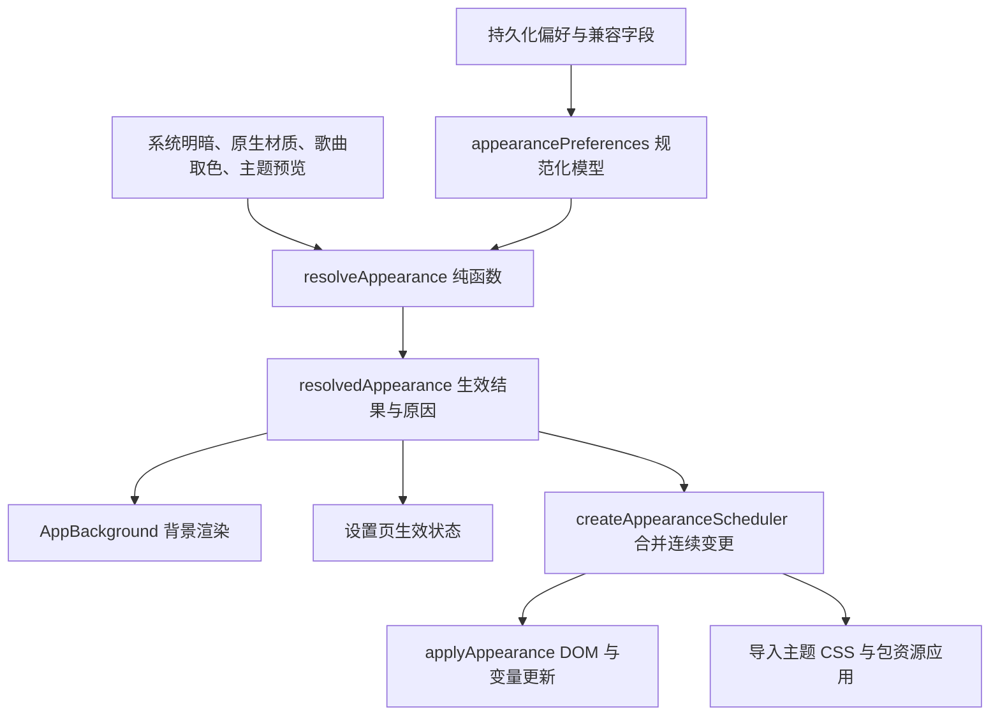

# 主题与背景规则及调度

本文描述当前实现。旧版混合“明暗、背景、主题”的规则已由统一外观解析替代。

## 状态流

解析不改写偏好；DOM 层不再自行决定优先级。调度读取最新状态，不会因一次更新尚未结束而丢弃后续变更。只在实际配色变化时写入根元素，明暗模式同帧切换，不让文字与底色插值经过灰底灰字；同一明暗及表面配色内的强调色变化保留过渡；导入主题改变文字/表面配色时同样原子应用。全局背景同帧替换，避免离场画布提前清空后继续淡出；页面与播放页过渡不受影响。

## 独立维度

| 维度       | 选择                             | 行为                                                |
| ---------- | -------------------------------- | --------------------------------------------------- |
| 明暗       | 浅色、深色、系统                 | 独立于背景和材质；主题不设置系统明暗                |
| 强调色来源 | 自动、自定义、场景、歌曲         | 主题明确声明的强调色优先；不可用时回退并解释        |
| 全局背景   | 无、内置场景、图片、视频         | 一次只有一个基础背景；保留主题的配色与控件样式      |
| 原生材质   | 关闭、平台支持的材质             | 暂时隐藏全局背景，不改写背景与明暗偏好              |
| 主题背景   | 使用、关闭                       | 仅对提供 replace 背景的主题有效，关闭仍保留主题配色 |
| 播放页     | 封面、环境、流体；封面样式与歌词 | 独立管理；全局主题重置不改变播放页外观              |

主界面背景优先级：**原生材质透明表面 → 启用的主题背景 → 选择的场景/图片/视频 → 普通表面**。

原生材质启用时选择的新背景会保存，关闭材质后显示。跟随系统只更新有效明暗，不禁用背景。

内置场景在深色模式下扩展配色；浅色模式对所有场景（含歌曲背景）使用统一浅色遮罩，避免深色画布与深色文字叠加。本地媒体背景的顶栏/底栏颜色也按浅色表面混合。背景自定义边框只影响窗口装饰，不再改写全局控件边框。

非主题覆盖的强调色在浅色模式中保留色相并限制明度；用户保存的颜色不变。歌曲原始填充仍单独计算黑/白前景，浅色模式也应用这套按钮对比度规则。

## 强调色来源

- 自动：有效场景使用场景配色；solid 场景有封面时使用歌曲取色；其他背景使用自定义颜色。
- 自定义：独立使用用户颜色。
- 场景：使用所选场景的颜色，即使背景暂时被材质或主题隐藏；没有场景时回退自定义颜色。
- 歌曲：有封面取色时使用封面色，不限制背景类型；缺失时回退自定义颜色。
- 有效导入主题声明了 `--color-primary`：覆盖以上来源，设置页显示“当前主题”。

设置页同时显示实际背景、强调色来源及隐藏/回退原因。自定义颜色仍可编辑，作为用户来源与回退值。

## 统一操作入口

- `setColorMode`：仅改变明暗选择。
- `selectThemeBackground`：选择基础背景，并关闭主题背景；不退出已选主题。
- `setCustomBackground`：本地媒体导入调用相同背景选择规则，不直接操作多个开关。
- `clearCustomBackground`：清除本地背景，不改变主题、强调色或明暗。
- `selectCustomTheme`：应用所选主题，默认启用其背景；选择默认主题时保留基础背景。
- `setNativeWindowMaterial`：等待主进程成功后更新材质状态，不再保存/恢复不断叠加的偏好快照。
- `resetTheme`：先关闭原生材质，成功后恢复主界面外观默认；失败不继续改写偏好。保留导入主题资源、播放页背景与封面样式。确认框等待异步完成并展示失败。

## 导入与预览兼容

主题 JSON/ZIP 格式保持 version 1；replace/inherit、变量、规则、图片、字体和文字接口保持兼容。

导入预览临时使用候选主题及其背景；取消/超时恢复先前主题和背景策略，确认才保存新主题及默认背景策略。预览状态不持久化。

未变化的主题复用原样式节点与样式表，避免配色更新导致图片/字体规则反复卸载。变量继续使用原有 CSS 契约：普通明暗基础值 → 场景配色 → 运行时变量 → 主题根级 tokens 的 !important。局部变量、组件样式和后代声明仍遵循 CSS 层叠规则。

## 存储与迁移

为了兼容现有偏好和导出数据，旧字段暂时保留为存储适配层；业务消费规范化模型和生效结果，不再组合判断多个旧开关。

- UI 偏好仍存入数据库 `pinia.ui.preferences.v1`。
- 新增 `accentSource`、`themeBackgroundEnabled` 和 `appearanceRulesVersion`。
- 首次初始化按旧 `themeBeforeMica` / `themeBeforeFollowingSystem` 快照恢复被旧规则覆盖的用户选择，随后清除快照并标记版本，避免重启重复迁移。
- `useMica` 与 `.mica-enabled` 保留为兼容接口；新逻辑使用 `nativeMaterialEnabled`，具体材质以主进程回读值为准。
- 无消费方的 `useDynamicBg`、`currentDynamicBg` 已移出状态及持久化列表。
- 原生材质仍由主进程 `window.material` 保存，兼容旧 `window.mica-enabled`。

## 代码边界

| 模块                                                | 职责                                                   |
| --------------------------------------------------- | ------------------------------------------------------ |
| `services/appearance.ts`                            | 类型、默认值、纯解析与覆盖/回退原因                    |
| `services/appearanceController.ts`                  | 合并调度、DOM 属性及语义变量应用                       |
| `stores/ui/uiStore.ts`                              | 兼容存储适配、操作入口、初始化迁移，与主题资源服务协调 |
| `components/background/AppBackground.vue`           | 按生效背景渲染，管理背景活动与歌曲取色                 |
| `components/background/systemBackgroundRegistry.ts` | 场景组件与元数据                                       |
| `services/customTheme.ts`、`themePreview.ts`        | 主题校验/CSS/资源应用与预览生命周期                    |
| `main/service/windowMaterialService.ts`             | 平台能力、原生调用、失败回滚与材质持久化               |
| `components/player/usePlayerBackdrop.ts`            | 播放页背景、取色、对比度与降级                         |

## 验证

- `npm run test:appearance`：288 组规则组合、来源回退、调度顺序，以及真实 Pinia、设置控件和背景组件的迁移/切换/预览/重启/失败重置检查。
- 增加所有内置场景在最暗背景下的浅色对比度检查（主文字 7:1、次级文字/强调色 4.5:1）、开启动画后的明暗切换逐帧采样、画布宿主保留及样式表重用检查。场景使用黑色画布占位，检验最暗背景边界，不依赖某一张动态背景截图。
- 原主题预览、窗口材质、偏好默认值、同步存储及 Chromium 主题层叠检查继续覆盖兼容契约。
- 原生系统材质外观和各场景的整页观感仍需在对应平台实际验收；隔离界面测试使用场景占位组件与模拟系统 IPC，不模拟原生材质成像。
