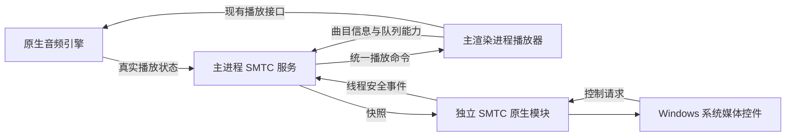

# Windows SMTC 接入方案

状态：已实现基本 SMTC 功能，以下保留设计依据与验收范围。

## 使用与验证

Windows 默认启用，在「设置 → 系统 → Windows 系统媒体控制」可即时开关并自动保存。
播放歌曲后，系统会话显示曲目信息和封面，提供上一首、播放/暂停、下一首；没有进度或 seek。
操作继续进入现有播放器队列和音频引擎。系统媒体键与全局媒体快捷键采用单一处理路径。

原生模块实际提供 `Session` 类，方法为 `ready()`、`update(snapshot)`、`artwork(bytes, revision)` 和 `close()`。
模块与音频引擎独立构建，产物 `easy_player_smtc.node` 已加入 Windows 打包资源。

验证命令：

- `npm run build:native`：配置并构建原生模块。
- `npm run test:smtc`：使用现有 CMake 构建目录编译模块和测试探针，验证真实 Windows 会话、按钮回调、无 seek、封面、窗口替换、命令确认与设置界面。
- `npm run typecheck`、`npm run test:shortcuts`、`node scripts/test-playback-events.mjs`、`npm run test:shuffle`：类型及已有播放器行为回归。

当前工作机已完成 Windows 11 原生会话验收；Windows 10、正式安装包显示身份及休眠恢复仍需在相应环境实测。

## 目标与技术选择

以用户描述的 Chrome / foobar 效果为目标，让 Easy Player 的当前曲目出现在 Windows 系统媒体控件中：三个操作位为上一首、播放/暂停、下一首，同时显示标题、歌手、专辑信息和封面。具体布局与显示字段由 Windows 和外部控制端决定。

本次范围不包含进度条、seek、播放速度、快进/快退、随机或循环控制。只发布曲目和播放状态，不发布时间线，也不注册进度或速度修改事件。

推荐新增独立的 **C++/WinRT + Node-API 模块 `easy_player_smtc.node`**，由 Electron 主进程管理。现有原生音频引擎继续负责音频输出；SMTC 只发布状态和接收控制请求。

| 路径                              | 对当前项目的评价                                                                                              |
| --------------------------------- | ------------------------------------------------------------------------------------------------------------- |
| 独立 Node-API 模块                | 推荐。与主窗口同进程，可直接绑定 HWND；已有 `easy_player_window.node` 的构建和加载方式可复用                  |
| 渲染进程 `navigator.mediaSession` | 当前音频由原生引擎输出，不能仅凭设置 Web Media Session 元数据假定系统会建立正确会话，需要额外验证，不作为首选 |
| 复用任务栏辅助 EXE                | 辅助进程不能直接使用主进程的 HWND 获取 SMTC；若自行创建窗口，还需处理独立进程的会话身份和生命周期，首版不采用 |

Windows 桌面接入使用 `ISystemMediaTransportControlsInterop::GetForWindow`，其 HWND 必须属于调用进程且是顶层窗口。[Microsoft 接口文档](https://learn.microsoft.com/en-us/windows/win32/api/systemmediatransportcontrolsinterop/nf-systemmediatransportcontrolsinterop-isystemmediatransportcontrolsinterop-getforwindow)

首版以项目 Electron 39 所支持的 Windows 环境为基础，验收 Windows 10/11；实际加载时探测接口能力，失败时保留应用正常播放和现有托盘、任务栏控制。

## 当前项目基础

- `src/main/index.ts` 已维护主窗口、托盘状态和系统控制接入点；轻量播放模式会创建替代主窗口。
- `src/main/service/thumbnailPlaybackService.ts` 已提供与窗口绑定、重建和退出释放的服务模式。
- `src/main/service/taskbarCoverPreview.ts` 已有封面处理及异步版本校验逻辑，可复用处理思路。
- `src/main/audioEngine/index.ts` 提供 `getStatus()` 和状态回调；真实播放状态可直接从主进程取得，无需订阅进度回调。
- `src/renderer/src/stores/player/playerStore.ts` 持有队列、上一首、下一首及播放操作，并通过 `tray:update` 发布曲目信息。
- `resources/lib/CMakeLists.txt` 已构建独立的 `easy_player_window.node`，可增加同级 SMTC target。

## 数据流与职责

主进程是系统媒体会话的唯一发布者。渲染进程补充队列信息，原生引擎提供实际状态；不让迷你播放器、桌面歌词和主窗口分别创建会话。

建议抽出 `playbackCommandService.ts`，让 SMTC、托盘和任务栏使用同一套入口。首版保留播放器 store 对队列的所有权，不为接入 SMTC 重写整个队列系统。

命令类型仅包含 `play`、`pause`、`previous`、`next`。界面中间的播放/暂停操作由系统根据发布的播放状态呈现；系统的明确播放/暂停命令分别调用幂等操作，不能都映射成 `toggle`。上一首和下一首继续走现有队列、随机播放和切歌逻辑。

命令携带 `requestId`、窗口代数和可选曲目版本，渲染进程返回处理结果。窗口切换期间暂停投递队列命令，不重放过期的上一首/下一首；渲染进程重新 attach 后再开放相应能力。超时或失败后按引擎真实状态重新发布快照，不预先宣称操作成功。

## 主进程与原生接口

计划新增：

| 文件                                             | 职责                                             |
| ------------------------------------------------ | ------------------------------------------------ |
| `src/shared/systemMediaControls.ts`              | 快照、命令、功能可用状态的共享类型               |
| `src/main/service/systemMediaControlsService.ts` | 初始化、窗口绑定、状态合并、节流、错误降级与释放 |
| `src/main/service/playbackCommandService.ts`     | 播放命令分发与结果确认                           |
| `engine-windows/src/smtc.cpp`                    | WinRT 会话、按钮事件、播放状态、元数据和封面更新 |

原生模块建议暴露 `attach(hwnd, onCommand)`、`update(snapshot)`、`setArtwork(bytes, revision)`、`setEnabled(enabled)`、`dispose()`。

快照至少包含：`sessionGeneration`、`trackRevision`、`hasTrack`、`title`、`artist`、`album`、`status`、`canPlay`、`canPause`、`canPrevious`、`canNext`。不传输位置、时长或播放速度。传递普通可序列化数据；原生层不持有 Vue 对象，也不接受任意脚本命令。

设置媒体类型为音乐。仅按实际能力开启 `IsPlayEnabled`、`IsPauseEnabled`、`IsPreviousEnabled`、`IsNextEnabled`；关闭停止、快进、快退等额外按钮能力。不调用 `UpdateTimelineProperties`。

HWND 通过 `BrowserWindow.getNativeWindowHandle()` 的 Buffer 传入，不经过 JavaScript Number，避免 64 位句柄精度丢失。

WinRT 对象在专用、串行的原生工作线程创建和销毁，由该线程初始化 COM apartment，避免干扰 Electron 主线程已有的 COM 状态。系统事件通过 `Napi::ThreadSafeFunction` 投递到 JS 线程。销毁前撤销事件，终止待处理任务，再释放回调与 WinRT 引用；环境 cleanup hook 覆盖异常退出路径。

SMTC 事件可能不在 UI 线程触发，不能直接操作 JS 或播放器 UI。[Microsoft 手动接入说明](https://learn.microsoft.com/en-us/windows/apps/develop/media-playback/system-media-transport-controls)

## 状态同步规则

| 播放器状态               | SMTC 行为                                    |
| ------------------------ | -------------------------------------------- |
| 无曲目、初始化中         | 控件禁用，不发布虚假的正在播放信息           |
| 正在加载新曲目           | `Changing`，及时替换曲目信息并清除上一首封面 |
| 播放                     | `Playing`，中间操作切换为暂停                |
| 暂停、已准备但未播放     | `Paused`，保留曲目信息，中间操作切换为播放   |
| 停止且保留曲目           | `Stopped`，保留曲目信息，按实际能力允许播放  |
| 清空曲目、关闭功能、退出 | 清除曲目信息，禁用控制并释放当前会话         |

状态变化、切歌、曲目信息或封面变化时更新，连续重复快照去重。稳定播放期间无需定时刷新，不增加进度轮询或周期时间线任务。

现有音频回调需要统一分发：从现有 `audioIpcHandlers.ts` 的事件入口向服务广播，或给 `AudioEngineManager` 增加多个订阅者。避免额外注册原生单一回调而覆盖现有播放器通知。

曲目快照携带版本和曲目标识，主进程先与引擎当前文件匹配，防止新曲目的状态混入上一首的标题或封面。元数据补齐、手动编辑标签及原生无缝切歌后均重新对齐快照。

## 封面与窗口生命周期

封面使用已经解析或缓存的本地资源，由主进程读取、缩放为有大小限制的 JPEG/PNG，再交给原生内存流。原生层不自行联网，不引入一条绕过网络代理的封面请求路径。

每次切歌递增 `trackRevision`，封面异步结果只有版本与会话代数都匹配时才能应用。缺失或处理失败时使用应用默认封面，不能沿用上一首图片。

初始化顺序：应用就绪、数据库打开、读取开关、主窗口创建、绑定 HWND，再订阅并发布播放快照。应用 AUMID 保持与现有 `com.huiiro.easyplayer` 及安装程序一致，安装包实测显示的名称和图标。

最小化、隐藏到托盘时保持会话；替代窗口成功接管后撤销旧窗口会话并绑定新 HWND，全量重发快照。旧窗口的关闭回调必须检查代数，不能误释放新会话。替代窗口加载失败时恢复旧绑定。

退出时先停止发布和接收命令，撤销事件并释放会话，再释放线程和模块资源。模块缺失、接口不可用或可恢复的 HRESULT 失败只禁用 SMTC，并记录诊断；原生模块仍在主进程内，访问违规等不可恢复错误不能靠 JS catch 隔离，需靠生命周期设计和原生测试防范。

## 设置、快捷键与构建

在「设置 → 系统」增加“Windows 系统媒体控制”，默认开启，仅 Windows 显示；数据库键建议 `system.smtc-enabled`。切换后即时生效并持久化，失败时回滚开关，避免界面状态与实际能力不符。非 Windows 使用空实现。

SMTC 正常工作时，系统媒体键交由系统选择目标会话。若用户把同一媒体键注册为全局快捷键，应明确提示冲突并采用单一处理入口，避免一次按键执行两次；普通 Ctrl/Alt 自定义快捷键继续保留。当前项目全局快捷键默认均为空，无需默认抢占媒体键。

原生 target 只在 Windows 构建，复用项目 Node-API 头文件和 Windows SDK，链接所需 WinRT/COM 系统库。增加模块定位函数、构建产物复制及 `electron-builder.yml` 的 `extraResources` 白名单；不修改通用解码、DSP 和音频回调线程。

## 分阶段实施与验收

1. **原型**：独立模块绑定主窗口，发布测试曲目，验证系统会话、身份、按钮回调和确定性释放，先确认 COM/线程及窗口重建的可行性。
2. **功能接入**：接入真实曲目、封面、播放状态和三个操作位；补齐托盘/任务栏命令复用、设置持久化及降级处理。
3. **稳定性验收**：验证原生无缝切歌、窗口替换、后台控制、安装包身份和休眠恢复。本次到此交付，不安排时间线或 seek 阶段。

自动化测试覆盖：状态映射、明确播放/暂停的幂等行为、过期命令、封面异步乱序、窗口重建、卸载后的回调、加载失败降级、设置落盘，以及非 Windows 不加载模块。检查只开启四种按钮命令能力、未注册进度或速度修改事件，稳定播放期间不产生周期更新。

Windows 集成验收同时使用系统 UI 与 GSMTC 查询/控制会话，检查标题、歌手、专辑、封面、播放状态及命令落地；覆盖 Windows 10/11、开发版与安装包、后台托盘、暂停后继续、轻量模式切换、无封面歌曲、网络歌曲、快速连切、休眠恢复和与浏览器同时播放。不同系统 UI 的可见控件不完全相同，不能仅靠界面截图判断能力。

通过标准：一次系统操作只触发一次播放器命令；后台控制有效；切歌后不残留旧封面；重新进入或重启后开关状态正确；关闭和退出后旧会话不可继续控制；接入不改变音频输出路径。
